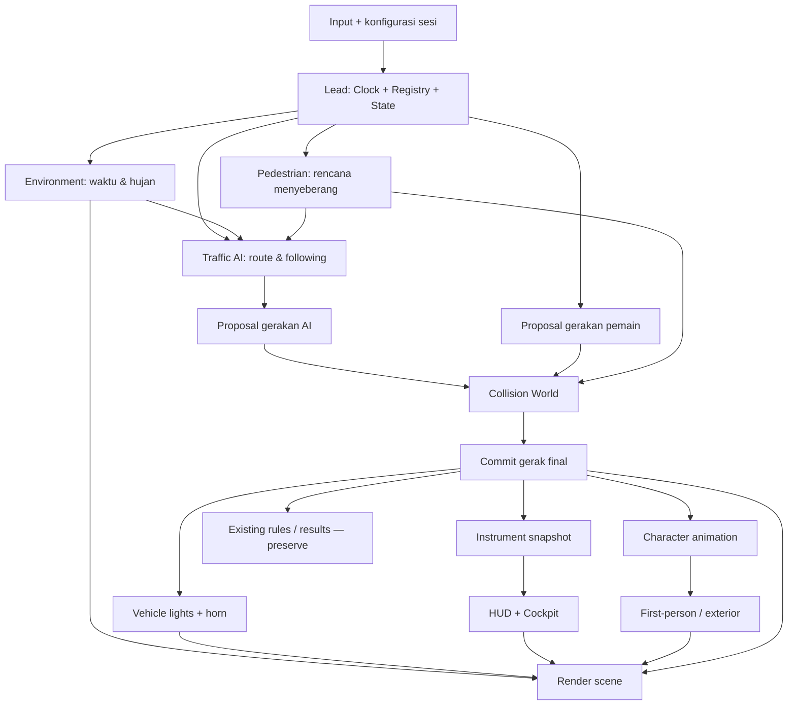
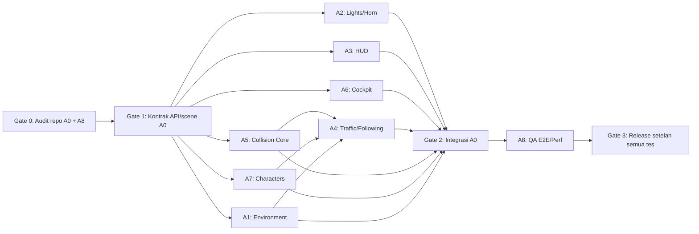

# MASTER IMPLEMENTATION PLAN — REALISME SIMULASI 3D KEMUDI.ID

> **Dokumen eksekusi untuk Codex multi-agent**  
> Status: spesifikasi dan rencana implementasi; **bukan** klaim fitur sudah diimplementasikan.  
> Basis analisis: `DOKUMENTASI_WEBSITE_DAN_SIMULASI.md` yang disediakan pemilik proyek pada 3 November 2026.  
> Target utama: **simulator browser Three.js/WebGL**, **bukan** proyek Unity.  
> Prioritas: benar-benar berfungsi, aman dari tabrakan tembus objek, teruji, performa terjaga, dan tidak merusak alur penyimpanan hasil.

---

## 0. PERINTAH UTAMA UNTUK CODEX / LEAD AGENT

Baca dokumen ini sampai selesai sebelum mengubah kode. Lakukan audit kode nyata dahulu. Gunakan beberapa agent paralel **hanya** untuk area kerja yang tidak saling bertabrakan. Semua perubahan harus masuk ke **sumber runtime** `src/Kemudi.Web/wwwroot/simulation-3d/`, kemudian diperbanyak oleh mekanisme build yang **sudah ada**, bukan dengan mengedit `Builds/WebGL/` sebagai sumber utama.

**Tujuan akhir:** menyempurnakan simulator mengemudi 3D Kemudi.id dengan:

1. Lingkungan pagi, siang, sore, malam, hujan, dan kombinasi waktu–hujan.
2. Lampu dan klakson yang bekerja pada **MOTOR, MOBIL, TRUK**, baik pemain maupun kendaraan AI; speedometer serta indikator lampu yang konsisten dengan status dunia 3D.
3. Lalu lintas AI motor/mobil/truk, pejalan kaki yang menyeberang, perilaku mengikuti kendaraan, antrean berhenti–jalan, patuh simpang, dan sistem anti-penetrasi untuk seluruh kendaraan.
4. Kamera first-person dengan kokpit/dasbor sungguhan untuk mobil/truk dan stang/instrumen untuk motor.
5. Aset karakter pengemudi/pengendara serta pejalan kaki dengan pipeline aset GLB, animasi dasar, dan fallback yang pasti dapat ditampilkan.

**Definisi selesai:** fitur bukan hanya menu/tombol dekoratif; objek visual, state, kontrol, AI, audio, dan pengujian harus terhubung. Lead Agent **wajib** menjalankan build dan tes yang memang tersedia, melaporkan bukti, dan mencatat yang belum berhasil.

### 0.1 Aturan tanpa negosiasi

- Audit file nyata sebelum coding. Nama file baru di dokumen ini adalah **usulan**, bukan bukti bahwa file tersebut telah ada.
- Jangan memindahkan implementasi ke Unity, memakai `VehiclePhysics` C# untuk browser, atau memperkenalkan ulang arsitektur fisika Unity.
- Jangan mengganti alur sesi: pilih kendaraan/transmisi → dekat kendaraan + `Enter` → `I` mesin → `Space` rem tangan → berkendara → finis/gagal → hasil.
- Jaga tombol lama: `W/S`, `A/D`, `Enter`, `I`, `Space`, `R`, `Shift`, `Q/E`, `C`, `P/Esc`, `B`, `H/J/G/F`. **Periksa `controls.js` sebelum menetapkan tombol baru**; tidak boleh membajak tombol lama.
- Jangan memutus parameter `vehicle=MOTOR|MOBIL|TRUK`, `transmission=manual|...`, `map=unified`, `autostart=1`, serta kompatibilitas map lama pada runtime.
- Jangan merusak `results.js`, `AttemptId`, skor/durasi/pelanggaran/keluar-jalur/benturan/status, gateway `/api/simulation/results`, dan dashboard. Jangan menambah field API/database tanpa alasan serta tes migrasi.
- Seluruh aktor bergerak (pemain/AI) mengikuti **satu** aturan koordinat, ukuran, tick, dan collision. Dilarang menggunakan logika collision terpisah yang saling kontradiktif.
- Semua fitur harus tetap bekerja saat dimainkan langsung dari server HTTP/WebGL mandiri, meski penyimpanan hasil akun memang tidak tersedia pada mode mandiri.
- Dilarang mendownload aset berhak cipta tanpa lisensi yang sah. Aset baru wajib memiliki sumber/asal, skrip generator (jika prosedural), serta ukuran/manifest yang masuk proses build.
- Bila repositori tidak menyediakan Blender/Meshy/generator GLB, buat **fallback karakter dan kokpit prosedural via Three.js** sebagai deliverable fungsional, dan laporkan GLB final sebagai pekerjaan yang belum bisa dilakukan; **jangan klaim model GLB sudah dibuat**.

---

## 1. HASIL ANALISIS DOKUMENTASI SAAT INI

| Area | Fakta yang didukung dokumentasi | Implikasi desain |
| --- | --- | --- |
| Runtime website | Blazor `Simulasi.razor` memuat `/simulation-3d/index.html` dalam `iframe`. | Semua modul baru harus berjalan di Three.js pada iframe, tidak bergantung pada halaman Blazor untuk loop simulasi. |
| Runtime kendaraan | Three.js dan model GLB lokal; `main.js`, `controls.js`, `vehicle.js` mengatur sesi/input/gerak; simulasi kinematik. | Tambah sistem gerak aman dan representasi collider dengan adaptor ke `vehicle.js` yang ada. |
| Lingkungan | Map `unified` menyambung perumahan, simpang, jalan panjang berkelok, simpang, dan finis; modul `city-track.js`, `track.js`, `long-road.js`, `intersection.js`. | Gunakan lintasan/map asli untuk AI dan zebra cross; jangan membuat jalan paralel yang tidak sesuai map. |
| Lalu lintas | Sudah ada kendaraan AI **demo**, lampu lalu lintas, marka simpang, deteksi benturan sederhana, dan `pedestrian.js`. | Audit/reuse perilaku dan objek yang ada; tingkatkan menjadi traffic system yang konsisten, tidak menduplikasi dengan AI lama. |
| HUD/audio | Sudah ada `hud.js`, `screens.js`, `audio.js`. | Perluas HUD/audio secara kompatibel, jangan buat overlay yang bertabrakan dengan UI sekarang. |
| Skor/hasil | `results.js` mengirim hasil akhir ke gateway website dan API progres dengan `AttemptId` idempoten. | Collision prevention bukan alasan untuk menghapus struktur `Collisions` atau merusak retry hasil. |
| Build | `tools/webgl/build.cjs` menyalin runtime, memvalidasi manifest aset kota/struktur GLB, dan menghasilkan manifest hash build. | Aset baru harus lolos verifikasi build, dengan manifest/hash yang selaras prosedur existing. |
| Unity | `simulation/Kemudi.Simulation/` terpisah dan tidak dimuat `/simulasi`. | Tidak disentuh kecuali ada permintaan terpisah. |

### 1.1 Hal yang **BELUM** dapat dipastikan hanya dari dokumen

Dokumentasi tidak membuktikan API ekspor masing-masing modul, struktur scene graph/arah sumbu model, kondisi cuaca dan pencahayaan yang sekarang, jenis/ukuran semua GLB, apakah data jalur AI tersedia, implementasi kamera, frekuensi update, collision yang dipakai, maupun tes yang lulus terakhir. Semua ini **wajib diverifikasi di source** pada fase audit. Hindari klaim “sudah ada/belum ada” selain yang dinyatakan eksplisit di tabel di atas.

### 1.2 Cakupan pekerjaan

**In-scope:** kode simulasi browser, asetnya, konfigurasi scene, UI simulasi, dokumentasi kontrol, unit/function tests, tes browser/WebGL, build asset. **Out-of-scope default:** perubahan backend/API/SQLite/login/checkout; migrasi ke Unity; VR/WebXR penuh; perangkat setir fisik; multiplayer; simulasi kecelakaan realistis/destruktif. Arsitektur kamera boleh disiapkan supaya kompatibel dengan VR di pekerjaan berikutnya, tetapi dokumen ini **tidak** mengklaim integrasi VR selesai.

---

## 2. DEFINISI PERILAKU YANG HARUS TERLIHAT DI SIMULASI

### 2.1 Waktu dan cuaca

| Mode | Target tampilan | Target gameplay |
| --- | --- | --- |
| Pagi | Cahaya matahari hangat rendah, bayangan memanjang, langit terang lembut. | Lampu kendaraan mengikuti kebutuhan visual/jam simulasi. |
| Siang | Cahaya kuat dan netral, jarak pandang terang, bayangan lebih pendek. | Baseline pencahayaan normal. |
| Sore | Matahari rendah keemasan, bayangan panjang, lingkungan mulai redup. | Headlamp AI/pemain dapat diaktifkan sesuai kebijakan mode. |
| Malam | Sky gelap, intensitas ambient diturunkan, lampu kendaraan, lampu jalan/simpang tetap jelas. | Perlu lampu depan untuk visibilitas; HUD tetap mudah dibaca. |
| Hujan ringan | Partikel hujan secukupnya, jalan basah/refleksi sederhana, langit mendung. | Visibilitas sedikit berkurang, jarak pengereman dan perilaku AI lebih konservatif. |
| Hujan deras | Hujan lebih padat, kabut ringan bila sesuai, percikan ban/fisik visual murah. | Turunkan grip/kecepatan aman AI, tambah jarak mengikuti, tetap bisa menyelesaikan sesi. |

- Waktu dan hujan merupakan **dua parameter independen**. Contoh: pagi cerah, sore hujan ringan, malam hujan deras.
- Preset jam simulasi awal yang **diusulkan**: `pagi=07:00`, `siang=12:00`, `sore=17:00`, `malam=21:00`. Boleh dibuat siklus waktu opsional dengan percepatan terkontrol; default preset stabil agar tes reproduktif.
- UI pengaturan di layar awal/pause untuk mengganti waktu/cuaca. URL baru opsional seperti `timeOfDay` dan `weather` **hanya setelah** dicek terhadap parameter existing. Default tetap kondisi lama/baseline jika parameter tidak ada.
- Hujan tidak boleh melintasi kaca/kabin di first-person seolah-olah terjadi di dalam mobil/truk. Untuk motor, hujan di luar tetap terlihat.
- Partikel, lampu, dan bayangan harus memiliki LOD; jangan membuat shadow-casting light per AI kendaraan.

### 2.2 Lampu dan klakson semua jenis kendaraan

| Fungsi | MOTOR | MOBIL | TRUK | Pemain | AI |
| --- | :---: | :---: | :---: | :---: | :---: |
| Lampu utama dekat (low beam) | ✓ | ✓ | ✓ | kontrol | otomatis/aturan |
| Lampu jauh (high beam) | ✓ | ✓ | ✓ | kontrol, jika sesuai | hanya saat sesuai, tidak menyilaukan lawan |
| Lampu belakang/posisi | ✓ | ✓ | ✓ | sinkron | sinkron |
| Lampu rem | ✓ | ✓ | ✓ | dari input/deselerasi | dari pengereman |
| Lampu sein kiri/kanan | ✓ | ✓ | ✓ | kontrol | saat belok/pindah arah |
| Hazard | bila sesuai prefab | ✓ | ✓ | kontrol | situasi berhenti darurat bila relevan |
| Lampu mundur | bila kendaraan memang memilikinya | ✓ | ✓ | dari mode mundur | dari mundur |
| Klakson | ✓ | ✓ | ✓ | ditekan → bunyi | event situasional, cooldown |

- **Satu status lampu** menjadi sumber kebenaran untuk mesh emissive, iluminasi dekat kendaraan, dan indikator HUD/kokpit.
- Sein dan hazard berkedip dengan clock simulasi (misalnya interval setengah siklus 0,4–0,5 detik); saat pause, kedipan membeku sesuai semantik pause saat ini.
- Lampu rem menyala ketika pengereman nyata, bukan hanya saat tombol `S` tertahan (termasuk AI yang mengerem untuk berhenti).
- Klakson memakai playback one-shot atau loop-while-held yang diberi batas, cooldown/anti-spam, dan aktif setelah kebijakan izin AudioContext browser terpenuhi. Gunakan pool audio agar 20 AI tidak membuat 20 audio context.
- Lampu AI bukan kosmetik: sein aktif sebelum belok; lampu malam/hujan mengikuti `environmentState`; lampu rem memberi petunjuk mengapa AI melambat.
- Titik posisi lampu harus disesuaikan dengan GLB nyata melalui metadata/anchor, tidak diasumsikan universal. Jika tidak ada anchor, fallback dibuat di bounding box kendaraan.
- Tombol baru **ditetapkan oleh Agent Lead setelah audit `controls.js`**, lalu ditampilkan dalam bantuan kontrol dan opsi remap jika tersedia. Jangan mengambil `H/J/G/F` yang sudah digunakan untuk perlengkapan motor.

### 2.3 Speedometer dan indikator

- HUD memperlihatkan **kecepatan riil dalam km/jam** (perhitungan dari kecepatan dunia dalam meter/detik dikali `3.6`, setelah skala satuan diverifikasi), bukan kecepatan dari input throttle.
- Tampilan minimal: angka besar `km/jam`, dial/bar yang halus, transmisi/gigi (`P/R/N/D` atau `1..n` sesuai sistem sekarang), engine on/off, rem tangan, lampu dekat/jauh, sein kiri/kanan, hazard, ikon rem, dan cuaca/waktu kecil bila tidak memenuhi layar.
- Kokpit first-person memakai **state yang sama** dengan HUD; tidak boleh ada dua angka speedometer berbeda.
- Saat kendaraan diam, kedua speedometer membaca 0; saat reverse kecepatan tetap magnitudo positif dengan indikator `R`, kecuali UI sengaja menggunakan format lain yang konsisten.
- Dashboard motor berupa instrument cluster pada stang; mobil dan truk instrument cluster di belakang kemudi. UI first-person tidak boleh menutup jalan atau mengganggu visibilitas.

### 2.4 AI kendaraan dan pejalan kaki

- Spawn **MOTOR, MOBIL, TRUK** AI menggunakan model/kelas kendaraan yang benar-benar tersedia; bila varian kurang, buat turunan visual yang sah dari prefab/model existing, bukan nama kendaraan palsu.
- Spawn berada pada lane/jalan yang sesuai dengan map `unified`. Ikuti arah, kecepatan aman, marka, lampu lalu lintas, dan prioritas penyeberang. Rute dari data jalan asli; jika graph belum ada, bangun adapter graph waypoint dari track existing.
- AI tidak memotong jalur melalui gedung, tidak membelok instan 90°, tidak memutar model terbalik, tidak spawn di atas kendaraan lain, tidak teleport di depan pemain.
- **Queue following:** saat pemain berhenti di depan AI pada jalur yang sama, AI di belakang mengurangi kecepatan, berhenti pada jarak aman, kemudian AI berikutnya juga berhenti. Setelah pemain maju, antrean bergerak bertahap tanpa saling menembus.
- **Penyeberang:** manusia bisa berjalan di trotoar dan menyeberang pada area crossing. Mobil/motor/truk berhenti memberi jalan sesuai aturan prioritas; pejalan kaki sendiri jangan spawn di tengah bumper atau teleport ke seberang.
- Jumlah target awal **konfigurabel** untuk desktop: misalnya 6 motor + 8 mobil + 3 truk + 6 pejalan kaki aktif di sekitar pemain, lalu ukur FPS dan turunkan dinamis jika diperlukan. Angka ini target pengujian awal, **bukan** fakta dari source.
- AI di luar area aktif dihapus secara aman atau didaur ulang (pooling) setelah tidak terlihat; jangan hapus kendaraan yang sedang dilihat atau sedang berinteraksi langsung dengan pemain.

### 2.5 Semua kendaraan tidak bisa saling menembus

**Interpretasi requirement:** kendaraan pemain dan AI **tidak boleh overlap/menembus/menyatu**. Untuk simulasi latihan, tabrakan fisik berkecepatan tinggi boleh diterjemahkan menjadi **gerak dibatasi/berhenti di kontak**, bukan memantul liar atau melewati target. Kontak/near-miss tetap boleh dihitung sebagai pelanggaran atau laporan sesuai aturan skor existing.

Sistem harus menangani setidaknya: pemain ↔ AI, AI ↔ AI, pemain ↔ kendaraan berhenti, AI ↔ kendaraan berhenti, dan kendaraan ↔ pejalan kaki (perilaku *avoid/stop*, tanpa menyakiti karakter). Hambatan lingkungan statis ditangani bila collider tersedia; jangan menjanjikan semua gedung solid sebelum audit collider map.

Pendekatan yang direkomendasikan:

1. Collider kendaraan **2D oriented bounding box pada bidang jalan** (atau capsule sesuai bentuk), dihitung dari dimensi model yang telah distandarisasi; bukan collision dari roda/mesh detail.
2. Broad phase `spatial hash/grid` atau indeks sekitar untuk menghindari semua-pasang `O(n²)` setiap frame.
3. Cek **swept movement** (perkiraan perpindahan kontinu terhadap frame berikutnya, substep/swept SAT/pendekatan conservative advancement) agar kecepatan tinggi tidak menembus.
4. Proposal movement setiap agen → resolusi kontak/jarak minimum → apply transform satu kali → sinkronisasi speed aktual dan rem.
5. AI **mengantisipasi** rintangan melalui desired speed dan pengereman sebelum engine collision memblokir; collision resolver adalah lapisan pengaman terakhir, bukan metode AI untuk mengemudi.
6. Saat spawn/respawn, validasi free-space. Jika salah, cari spawn valid; jangan menerapkan teleport kendaraan lain secara mendadak.
7. Jika tidak bisa bergerak, throttle pemain tidak menyebabkan terus maju menembus; state gerak mendekati nol dan indikator tetap valid.
8. Batas uji awal overlap kendaraan bergerak pada kondisi normal **≤ 0,05 m** (toleransi numerik yang boleh disesuaikan setelah verifikasi skala scene). Tidak boleh ada penetrasi visual jelas atau menembus pada FPS rendah.

Catatan: traffic AI harus membaca collider pemain meskipun pemain mati mesin, rem tangan aktif, atau tidak melakukan input apa pun.

### 2.6 Kamera first-person, kokpit, dan karakter

**Mobil**: interior kabin menampilkan dasbor, cluster kecepatan, setir, bagian atas tangan pengemudi jika sesuai, bagian depan/tepi pintu, kaca depan; kamera ditempatkan di mata pengemudi tanpa clipping kepala atau terhalang atap. Kemudi berputar sesuai steering, lampu indikator menyala mengikuti state.

**Truk**: tempat duduk lebih tinggi, kabin dan dashboard proporsional truk, setir lebih besar, cluster dan kaca depan dengan posisi benar, perspektif jalan sesuai tinggi pengemudi truk; kamera tidak sama persis dengan mobil.

**Motor**: kamera posisi mata pengendara, stang, grip, speedometer/instrument cluster, bagian tangan/ lengan bila memungkinkan. Stang berbelok dan sedikit lean sesuai gerak; jangan menampilkan dashboard mobil pada motor.

**Karakter**:

- Buat satu humanoid dasar dengan variasi **pengemudi mobil, sopir truk, pengendara motor, pejalan kaki**.
- Pengendara motor memakai helm yang terlihat. Pengemudi mobil/truk memakai postur duduk yang benar. AI dan pemain boleh memakai varian berbeda.
- Karakter memiliki spawn anchor (`seatDriver`, `gripLeft`, `gripRight`, `footLeft`, `footRight`, `headEye` jika memungkinkan), pivot konsisten, material wajar, LOD, dan animasi minimal `idle`, `driving/steering`, `riding`, `walking`, `waiting`, `crossing`.
- Agar bisa dikirim sebagai aset nyata, prioritas pertama adalah **GLB buatan sendiri** dari Blender/script yang tersedia di environment; alternatif legal adalah aset dengan lisensi disimpan dalam manifest beserta atribusi. Fallback wajib: manusia low-poly dibuat langsung dari geometri Three.js bila tool ekspor GLB tidak ada.
- Pada first-person jangan menampilkan seluruh kepala/avatar pemain sehingga kamera masuk ke model wajah. Mode kokpit bisa menyembunyikan mesh kepala lokal saja, tanpa menyembunyikan tubuh bagi kamera luar.

---

## 3. ARSITEKTUR USULAN (ADAPTIF TERHADAP SOURCE)

Semua path di bawah **usulan tambahan** di bawah `src/Kemudi.Web/wwwroot/simulation-3d/`. Jika struktur modul existing berbeda, Lead membuat peta adaptor, bukan memaksakan rename besar-besaran.

```text
simulation-3d/
  main.js                         # EXISTING — orchestrasi; hanya Lead yang menyatukan
  controls.js                     # EXISTING — mapping input; hanya Lead
  vehicle.js                      # EXISTING — implementasi vehicle; Agent Collision terkoordinasi
  hud.js                          # EXISTING — dibuka untuk Agent Instrument
  audio.js                        # EXISTING — dibuka untuk Agent Lighting/Audio
  pedestrian.js                   # EXISTING — audit/migrasi khusus Agent Traffic
  results.js                      # EXISTING — jangan ubah tanpa alasan kuat
  systems/                       # NEW, nama dapat disesuaikan
    simulation-state.js           # kontrak/facade state, dirilis oleh Lead
    environment-system.js         # waktu, langit, cahaya, cuaca
    road-surface-weather.js       # visual jalan basah, optimisasi
    vehicle-light-system.js       # visual lampu dan state
    horn-system.js                # event dan throttle audio
    instrument-system.js          # state speedometer + bridge ke HUD/kokpit
    traffic-system.js             # pengaturan AI dan spawn
    traffic-routes.js             # lane/rute dari map existing
    pedestrian-system.js          # crossing & behavior
    collision-system.js           # broadphase, sweep, transform constraints
    cockpit-system.js             # kameraframe, interior kendaraan
    character-system.js           # pengemudi/pejalan kaki/fallback
  models/characters/              # NEW jika dapat menghasilkan aset GLB
  models/cockpits/                # NEW jika GLB kokpit terpisah diperlukan
  docs/                           # NEW, manual pemetaan anchors/mapping kontrol
```

### 3.1 Kontrak state bersama — implementasikan pada Gate 1

Lead harus mempublikasikan kontrak **JS module/JSDoc** sederhana (hindari framework/TypeScript baru kecuali source sudah memakainya):

```js
// SKEMA USULAN, BUKAN EXPORT YANG SUDAH ADA DI REPO.
// Semua koordinat dan ukuran distandarkan setelah audit unit/sumbu model.
/**
 * @typedef {'MOTOR'|'MOBIL'|'TRUK'} VehicleType
 * @typedef {'player'|'ai'} VehicleRole
 * @typedef {{lowBeam:boolean, highBeam:boolean, tail:boolean,
 *   brake:boolean, reverse:boolean, left:boolean, right:boolean,
 *   hazard:boolean}} VehicleLightState
 * @typedef {{id:string, type:VehicleType, role:VehicleRole,
 *   object3D:import('three').Object3D,
 *   position:import('three').Vector3, yawRadians:number,
 *   velocityMps:number, actualSpeedKph:number,
 *   lengthM:number, widthM:number,
 *   lights:VehicleLightState, hornActive:boolean,
 *   brakeDemand:number, steeringDemand:number,
 *   engineOn:boolean, gear:string|number,
 *   routeId?:string, active:boolean}} SimVehicle
 * @typedef {{timeOfDay:'pagi'|'siang'|'sore'|'malam',
 *   hour:number, rainIntensity:number, wetness:number,
 *   visibilityFactor:number, roadGripFactor:number}} EnvironmentState
 */
```

**Aturan kontrak:** `vehicle.js` boleh memiliki struktur internal sendiri; buat adapter `toSimVehicle(existing)` atau facade, **jangan** mengubah semua pemanggil lama sekaligus. Semua kecepatan menggunakan unit kanonik `m/s`, tampilan `km/jam`. Verifikasi `1 scene unit == 1 m` atau definisikan faktor konversi eksplisit. Nilai satuan tidak boleh ditebak.

**Satu sumber kebenaran:** `EnvironmentState`, `SimVehicle`/facade, `VehicleLightState`, `SimulationClock`, `RouteGraph`, `CollisionWorld`, dan `InstrumentSnapshot`. Tidak ada agent menyimpan speed/lampu/collision “versinya sendiri” tanpa sinkronisasi.

### 3.2 API modul yang harus disepakati sebelum paralel coding

| Penyedia | Interface minimum (bentuk final disepakati setelah audit) | Konsumen |
| --- | --- | --- |
| Lead/Core | `getVehicles()`, `getPlayerVehicle()`, `getEnvironment()`, `getClock()`, event subscribe | Semua |
| Environment | `init(scene, map)`, `setTimeOfDay(mode)`, `setWeather(mode/intensity)`, `update(dt)`, `getState()`, `dispose()` | AI, lighting, render, HUD |
| Lighting/Audio | `registerVehicle(v,anchors)`, `setLightState(id,state)`, `triggerHorn(id,pressed)`, `update(dt,env)`, `unregisterVehicle(id)` | Input, AI, rendering, instruments |
| Instrument | `snapshotFromVehicle(v)`, `renderHud(snapshot)`, `renderCockpit(snapshot)` | HUD dan cockpit |
| Traffic | `init(routeGraph,registry)`, `spawn()`, `plan(dt,env)`, `applyResolvedMotion()`, `dispose()` | Collision, Lead |
| Pedestrian | `spawnAtCrossings()`, `plan(dt)`, `getActiveAgents()`, `update(dt)` | Traffic dan collision |
| Collision | `registerBody(entity,shape)`, `canSpawn(shape)`, `resolveMovement(id,proposedDelta,dt)`, `getLeadObstacle(id,lane)` | Player movement, traffic, pedestrian |
| Cockpit | `attachToVehicle(v)`, `setMode(mode)`, `update(dt,vehicle,instruments)`, `dispose()` | Camera cycle dan character |
| Characters | `createCharacter(role,variant)`, `attachToVehicle(char,v)`, `playAnimation(name)`, `setLOD(...)` | Player/AI vehicles, pedestrian |

API di tabel adalah **kontrak desain**; Lead bebas memakai nama final lain jika lebih cocok dengan source, tetapi harus dicatat dalam `docs/REALISM_INTEGRATION_CONTRACT.md` **sebelum** sub-agent mulai implementasi.

### 3.3 Urutan update per fixed tick — penting untuk menghindari ghosting

```text
1. Poll controls (pemain) dan update clock/pause state
2. Baca environment, lampu lalu lintas, geometri lane/crosswalk
3. Pedestrian plan → tujuan/niat menyeberang
4. AI traffic plan → desiredSpeed, braking, indicator, route
5. Player vehicle plan → desired position/velocity dari input lama
6. Collision world resolve untuk SEMUA proposal gerak (bukan setelah objek digeser)
7. Commit transforms, kecepatan aktual, state rem/gear
8. Update lampu, klakson, karakter/animasi, instrumen dan kamera
9. Render/interpolasi visual, bukan menggerakkan fisika kedua kali
```

- Tick target: `fixedDt=1/60s`, akumulator dengan batas catch-up steps (misalnya maksimal 4–5) untuk kestabilan. Jangan mengubah timing existing tanpa tes regresi gerak/transmisi.
- Frame-rate independen. Saat `pause`/tab tidak aktif, jangan membiarkan delta besar menabrakkan semua AI; reset/clamp akumulator sesuai mekanisme pause saat ini.
- Clock kedipan lampu, AI, dan animasi harus konsisten dengan pause. Audio dihentikan/ditahan sesuai perilaku yang masuk akal.
- Pisahkan gerak fisika dan interpolasi visual untuk tidak mengubah collider setelah resolusi.
- Jika source existing sudah memiliki loop stabil, bungkus urutan tersebut tanpa refactor masif.

### 3.4 Diagram integrasi



---

## 4. PEMBAGIAN KERJA MULTI-AGENT DAN KEPEMILIKAN FILE

### 4.1 Aturan koordinasi

**Lead (A0)** adalah satu-satunya pengubah `main.js`, `controls.js`, `screens.js`/menu global, dan perubahan build umum `tools/webgl/build.cjs`. Agent lain bekerja di modul baru dan file existing yang menjadi milik agent itu saja. Tidak ada dua agent menulis file sama secara paralel. Jika agent memerlukan perubahan pada file milik agent lain, tulis **Integration Request** (fungsi yang harus dipanggil, event, lokasi hook), bukan mengeditnya diam-diam.

| Agent | Fokus / deliverable | File yang boleh dimiliki | Dilarang diedit langsung |
| --- | --- | --- | --- |
| **A0 — Lead/Integrator** | Audit, kontrak bersama, mapping controls, integrasi loop, merge, docs, build | `main.js`, `controls.js`, `screens.js`, `systems/simulation-state.js`, docs integrasi, `tools/webgl/build.cjs` | `vehicle.js`, `hud.js`, `audio.js`, modul khusus agent lain saat paralel |
| **A1 — Environment** | Pagi/siang/sore/malam, hujan, wet road, preset & perf | `systems/environment-system.js`, `systems/road-surface-weather.js` | `main.js`, `city-track.js`, `intersection.js` tanpa tiket integrasi |
| **A2 — Vehicle Lights & Audio** | Lampu lengkap, horn, AI auto-light, anchors | `systems/vehicle-light-system.js`, `systems/horn-system.js`, `audio.js` | `controls.js`, `vehicle.js`, `main.js` |
| **A3 — Instruments & HUD** | Speedometer pemain, status lampu, cluster data, aksesibilitas | `systems/instrument-system.js`, `hud.js` | `main.js`, `controls.js`, file kokpit A6 |
| **A4 — Traffic & Pedestrians** | Route graph, spawn AI motor/mobil/truk, stop-go queues, crossing | `systems/traffic-system.js`, `systems/traffic-routes.js`, `systems/pedestrian-system.js`, `pedestrian.js` | `vehicle.js`, `main.js`, `systems/collision-system.js` |
| **A5 — Collision & Motion Safety** | Body shape, broadphase, swept motion, non-penetration, adapter kendaraan | `systems/collision-system.js`, `vehicle.js` | `main.js`, modul AI A4 |
| **A6 — Cockpit & Camera** | First-person mobil/truk/motor, dashboard/stang, speedometer cockpit, kamera C | `systems/cockpit-system.js`, `models/cockpits/` dan data anchor kamera | `main.js`, `hud.js`, karakter A7 |
| **A7 — Character & Assets** | Karakter driver/rider/pedestrian, animasi, GLB/procedural fallback, atribusi | `systems/character-system.js`, `models/characters/`, skrip generator `tools/` yang khusus aset karakter | `main.js`, `vehicle.js`, `pedestrian.js` |
| **A8 — QA/Perf** | Tes kontrak, unit, browser, regressions, perf, bukti manual | Test files dalam `tools/webgl/` (nama baru mengikuti struktur nyata), test fixtures, laporan QA | Source simulasi ketika agent fitur masih bekerja; berikan bug report |

> **Khusus `tools/webgl/`:** A7 hanya membuat file dalam subfolder generator aset yang dibuat khusus; A8 hanya mengedit/menambah tes; A0 memiliki `build.cjs`/`package.json` dan koordinasi skrip tes. Hindari bentrok path.

### 4.2 Dependensi kerja (bukan sekadar “jalankan semuanya bersamaan”)



A4 boleh mulai mengaudit lane/waypoint dan membuat route data paralel sejak Gate 1, namun **perilaku anti-tabrakan/queue baru dapat dinyatakan selesai setelah A5 menyediakan API collision yang stabil**.

---

## 5. TASK DETAIL PER AGENT — SIAP DIJADIKAN TIKET CODEX

### GATE 0 — Audit dan baseline (A0 + A8, wajib pertama)

**Input:** source repo aktual dan dokumentasi ini.

- [ ] Cek `main.js`, `controls.js`, `vehicle.js`, `hud.js`, `audio.js`, `pedestrian.js`, `results.js`, `intersection.js`, `city-track.js`, `track.js`, `long-road.js`, asset loader dan camera cycle.
- [ ] Inventarisasi model GLB kendaraan; nama node lampu/roda/kabin; ukuran/model orientation, frame koordinat, posisi duduk, box kendaraan; jangan berasumsi truk dan mobil memiliki anchor sama.
- [ ] Petakan siklus game, data kecepatan, input, perhitungan skor/benturan, lighting, AI existing, traffic signal, crossing serta kontrol tombol yang belum terpakai.
- [ ] Uji baseline build dan function tests existing; catat hasil serta output, bukan klaim lulus tanpa eksekusi.
- [ ] Identifikasi loader/path asset dan semua tempat render `hud`/kamera; catat update function nyata dan risiko integrasi.
- [ ] Buat `docs/REALISM_BASELINE_AUDIT.md` berisi **fakta source**, path/function ditemukan, gap dari requirement, screens/tes baseline, dan strategi migrasi AI demo tanpa duplikasi.

**Exit gate:** tabel fungsi/ekspor source dan tabel tombol telah terverifikasi, pemilik file disetujui, baseline tercatat.

### GATE 1 — Kontrak & fondasi bersama (A0)

- [ ] Definisikan `SimVehicle` facade, snapshot instrumen, `EnvironmentState`, `SimulationClock`, `RouteGraph`, `CollisionShape`, event names, dan lifecycle `init/update/dispose`.
- [ ] Standarkan orientasi: sumbu up Three.js, forward lokal model, konversi yaw, meter/s dan km/h. Tulis adapter per model jika asset orientation berbeda.
- [ ] Tentukan update ordering dan ownership entity IDs (IDs stabil, unik, tidak reuse sebelum unregister).
- [ ] Buat registrasi entitas pemain/AI dan hook event/clock minimal; tidak boleh menduplikasi scene registry existing jika sudah cocok.
- [ ] Tulis `docs/REALISM_INTEGRATION_CONTRACT.md` dan contoh adapter valid.
- [ ] Freeze kontrak versi `v1`, beri semua agent salinan, lalu paralelkan pekerjaan.

**Exit gate:** minimal smoke test dapat membaca state pemain (tipe, transform, speed, gearbox, light state), menulis proposal movement, dan menambah/menghapus AI entity tanpa error. Bila perlu dependency pada collision placeholder, tandai jelas.

### A1 — Sistem environment dan cuaca

**Implementasi:**

- [ ] Waktu preset `pagi`, `siang`, `sore`, `malam`; transisi sky/ambient/directional sun/fog/exposure berdasarkan data environment.
- [ ] Hujan `off`, `light`, `heavy`, partikel pooled di sekitar kamera, bukan di seluruh map; material wet-road disesuaikan scene, jangan membebani shader WebGL tak tersedia.
- [ ] Lampu jalan dan lampu bangunan aktif saat malam (jika model mendukung; buat fallback prop jika perlu), lampu traffic light selalu terbaca dan tidak tertutup exposure.
- [ ] Sediakan `visibilityFactor`, `roadGripFactor` dan `recommendedAIMaxSpeedFactor` yang dipakai A4/A5; bedakan fisika nyata dari kosmetik.
- [ ] Pause, resize, mode kamera, dan saat `dispose` aman; tidak menyebabkan memory leak/particle menumpuk.
- [ ] Tes: seluruh 4×3 kombinasi waktu dan hujan dapat berpindah tanpa reload serta semua lampu simpang masih jelas.

**Deliverable:** modul environment, konfigurasi preset, integration hook dan bukti screenshot/smoke test.

### A2 — Lampu lengkap dan klakson

**Implementasi:**

- [ ] Audit anchors lampu nyata per jenis GLB; buat vehicle light rig reusable dengan marker/metadata atau fallback ukuran box.
- [ ] Posisi dan orientasi: motor punya lampu depan/belakang; mobil/truk punya lampu kiri–kanan, brake, reverse, sein. Tidak menempatkan semua glow pada satu titik dunia.
- [ ] State headlights/taillights/brake/reverse/signals/hazard; sinkron visual, emissive material yang aman saat instancing/cloning, dan indikator.
- [ ] Low/high beam memiliki efek jangkauan visual yang berbeda tanpa menambah terlalu banyak dynamic lights; LOD berdasarkan jarak.
- [ ] AI otomatis aktifkan low beam saat gelap/hujan; sein pra-belok; rem sesuai deselerasi aktual. Pemain mengikuti input yang ditentukan Lead.
- [ ] Horn audio motor/mobil/truk dengan suara berbeda bila aset legal tersedia; fallback synthesis/percussive procedural yang aman, tanpa suara kosong.
- [ ] Perbaiki integrasi `audio.js` bila perlu, tanpa menghilangkan suara mesin/bunyi lama.
- [ ] Tes: tiap jenis × player/AI, status lampu tepat, kedip konsisten, horn cooldown, audio tidak membuat error pada autoplay policy.

**Deliverable:** lampu 3D benar-benar terlihat, suara klakson terdengar setelah audio enabled, API untuk AI/player, serta report anchor mapping.

### A3 — Instrument cluster dan HUD

**Implementasi:**

- [ ] Buat `InstrumentSnapshot` dihitung **setelah** collision commit dari kecepatan aktual; tampilkan speed km/h dan gear.
- [ ] Modifikasi `hud.js` secara minimal: dial dan angka dengan tampilan responsive, indikator lampu utama/jauh/sein/hazard/rem tangan/engine, tampilan `R`/gigi sesuai existing.
- [ ] Berikan antarmuka render yang bisa digunakan A6 pada speedometer kokpit tanpa menggandakan logika.
- [ ] Warna/kontras HUD malam/hujan, teks/ikon dapat dibaca; tidak memblok tombol pause atau finish screen.
- [ ] Tes nilai nol saat berhenti, sinkron nilai saat berpindah kamera, saat engine off, gear manual/otomatis, dan saat collision memblokir gerak.

**Deliverable:** HUD yang terhubung ke actual physics state, instrument snapshot interface, test.

### A5 — Collision core, mandatory sebelum fitur antrean dianggap selesai

**Implementasi:**

- [ ] Audit `vehicle.js` dan deteksi benturan existing; pisahkan rules/scoring event dari physical movement prevention.
- [ ] Collider OBB/capsule per kendaraan dengan dimensi jenis model nyata; include pemain, motor AI, mobil AI, truk AI, kendaraan diam.
- [ ] Broadphase spatial-hash (atau teknik setara) dan continuous/swept prediction terhadap objek bergerak/berhenti pada update frame.
- [ ] Integrasi player movement agar **propose → resolve → commit**. Jangan pindahkan pemain dulu baru koreksi kasar yang menghasilkan jitter parah.
- [ ] Resolusi AI–AI harus konsisten, termasuk dua kendaraan bergerak saling mendekat dan berhenti berbarengan.
- [ ] Expose `getLeadObstacle`/distance query supaya A4 dapat mengikuti kendaraan **pemain maupun AI**.
- [ ] Pedestrian crossing ditangani lewat proximity/yield + safety constraint: kendaraan berhenti sebelum zona penyeberangan; hindari merender “tabrakan dengan manusia” sebagai penalti visual kasar.
- [ ] Anti-spawn overlap, proteksi terhadap `dt` besar dan speed ekstrem, reset body saat ganti kendaraan/map.
- [ ] Pertahankan sinyal `collision/contact` untuk skor bila sistem existing membutuhkannya; `preventedCollision` dan `actualContact` dibedakan dengan jelas.
- [ ] Tes unit/sim: car↔car, car↔motor, truck↔motor, player↔AI, AI↔AI, stopped target, reverse, head-on, 15/30/60 FPS dan tab throttling.

**Deliverable:** collider integrated dan tes deterministik anti-penetrasi; dokumentasi toleransi serta batasan geometry static.

### A4 — Traffic manager, antrean, dan penyeberang

**Implementasi:**

- [ ] Petakan jalur dari `city-track.js`, `track.js`, `long-road.js`, `intersection.js` dan AI demo yang sudah ada; buat `RouteGraph` atau waypoint yang mencakup sambungan `unified`.
- [ ] Model AI sesuai pilihan kendaraan existing, variasi prefab sah; kontrol kecepatan, lane follow, yaw smoothing, radius belok, stop line dan traffic light.
- [ ] AI state machine contoh: `CRUISE → FOLLOW → BRAKING → STOPPED → RESUME`, dengan state prioritas `RED_LIGHT`, `YIELD_PEDESTRIAN`, `BLOCKED`. Satu alasan berhenti boleh memiliki prioritas tertinggi.
- [ ] Car following berbasis jarak antar bumper dan kecepatan relatif; contoh jarak target awal `baseGap + speedMps * timeHeadway`, dikalibrasi per motor/mobil/truk dan hujan. Gunakan kemampuan pengereman yang sesuai.
- [ ] Queue chain: AI3 ikuti AI2, AI2 ikuti AI1, AI1 ikuti pemain; semua berhenti. Saat pemain jalan, AI1 dahulu lalu AI2/3. Hindari balapan memperbarui target dari posisi frame yang sudah berubah.
- [ ] Track traffic light existing (jangan buat dua pengontrol sinyal) dan zebra crossing. Pejalan kaki memakai sisi/jalur masuk keluar crossing, animasi berjalan menyesuaikan kecepatan.
- [ ] AI memberi jalan pada penyeberang, termasuk yang sudah masuk crossing ketika lampu berubah; pedestrian tidak dipindah paksa bila pemain mendekat.
- [ ] Spawn memakai validasi A5; hanya melahirkan AI di lokasi yang tidak bertabrakan, dengan kepadatan dan jarak render dibatasi.
- [ ] Perilaku fallback ketika graph map tidak lengkap harus terukur (AI berhenti aman atau despawn di luar view), **bukan** menembus obstacle.
- [ ] Tes tiga jenis AI serentak, siklus stop-go 20x, persimpangan, crossing, anti-deadlock/AI stuck, traffic law, dan rain speed factor.

**Deliverable:** traffic management yang menggantikan/mengadaptasi AI demo tanpa duplikasi, rute map, dan tes antrean.

### A6 — Kamera kokpit, first-person per jenis kendaraan

**Implementasi:**

- [ ] Audit camera mode `C` yang ada; tambah mode kokpit pada siklus kamera tanpa menghapus mode lama atau melanggar pause.
- [ ] Posisi kamera `seatEye` tiap kendaraan; nearest clipping dan culling mesh kepala avatar khusus pemain supaya tidak menghalangi pandangan.
- [ ] Kokpit **MOBIL**: dashboard, setir berputar, speedometer instrument bridge, panel/permukaan kabin, kaca depan terlihat.
- [ ] Kokpit **TRUK**: dashboard dan setir proporsional truk, posisi mata lebih tinggi, bidang pandang jalan benar, instrumen terbaca.
- [ ] **MOTOR**: stang, grip, meter speed dan lampu, kamera mengikuti yaw/lean secara terkendali, tanpa head bob berlebihan.
- [ ] Prefab cockpit procedural wajib ada jika interior GLB existing tidak tersedia; jika membuat GLB sendiri, ikuti anchor dan performa.
- [ ] Kamera first-person tidak menembus atap, tidak terlalu dekat dashboard, dan mata tidak berada di luar kendaraan saat setir belok. Atur FOV konservatif dan manfaatkan VR-ready camera rig tanpa mengaktifkan WebXR.
- [ ] Gunakan `InstrumentSnapshot` A3, karakter A7 untuk tangan/pose bila tersedia, dan environment A1 untuk visibilitas hujan.
- [ ] Tes semua 3 jenis kendaraan × transmisi manual/otomatis × siang/malam/hujan × mode kamera berulang.

**Deliverable:** model/fallback visual interior, anchor mapping, sistem kamera first-person stabil, bukti tampilan per jenis.

### A7 — Produksi aset karakter yang benar-benar muncul di runtime

**Kebutuhan aset minimum:**

| Nama aset yang diharapkan | Tipe | Pose/fitur minimum | Pemakaian |
| --- | --- | --- | --- |
| `driver_base.glb` | humanoid | seated pose + tulang tangan/kepala atau transform anchor yang setara | Pengemudi mobil AI/player |
| `truck_driver.glb` | humanoid/turunan | seated pose, ukuran/seat alignment truk | Sopir truk |
| `motor_rider.glb` | humanoid | helm, riding pose, grip kiri/kanan di stang | Motor pemain/AI |
| `pedestrian_base.glb` | humanoid | walking/idle, dua arah penyeberangan | Pejalan kaki |
| Varian visual | material/mesh variant | minimal beberapa pakaian/warna/helm berbeda | Menghindari clone identik |

Nama di atas **target output**, bukan file yang sudah ada. Saat mengekspor GLB, dokumentasikan rig/bone naming atau anchor matrices. Dalam environment yang tidak mendukung ekspor GLB, buat fallback prosedural runtime dengan antarmuka yang sama. Jangan mendaftarkan file `.glb` di manifest apabila file sebenarnya tidak dihasilkan.

- [ ] Audit model kendaraan dan skala meter/proporsi seat. Buat **asset spec** berupa dimensi/avatar height, local-axis convention, hand grips, helmet placement, LOD limits dan material.
- [ ] Usahakan script generator karakter sendiri (misalnya Blender Python + glTF export) bila Blender tersedia; validasi GLB load di Three.js sebelum mengklaim selesai.
- [ ] Jika Blender tidak tersedia, implementasikan avatar low-poly dari `THREE.Group`/geometri sederhana dengan 4 rig kategori dan minimal animation via rotasi lengan/kaki/transforms; tampilkan benar-benar di scene sebagai fallback.
- [ ] Buat `character-system.js` dengan `createCharacter(role,variant)`, `mountToSeat`, `mountToMotor`, `walk`, `setLOD`, `dispose`, dan fallback model yang tidak gagal jika GLB invalid.
- [ ] Tambahkan aksesori helm untuk pengendara motor; pakaian dan wajah non-identifiable/orisinal; variasi warna/ukuran wajar.
- [ ] Siapkan state `idle`, `driving`, `steering`, `riding`, `walking`, `waiting`, `crossing`. Animasi sederhana cukup **jika benar terlihat**; GLB dengan rig/animation yang lebih baik boleh dibuat kemudian.
- [ ] Hindari mengganggu collider: collider pengendara biasanya bagian dari body kendaraan, collider pejalan kaki terpisah dari visual bone animation.
- [ ] Aset baru punya manifest asal/lisensi, script generator, ukuran file dan hash/build validation; jangan mengubah asset hash kota tanpa update yang sah.
- [ ] Tes karakter melekat pada kendaraan di jalan berbelok/hujan, tidak terbang dari seat, tidak berkedip saat kamera berganti, dan pejalan kaki punya siklus kaki yang terlihat.

**Deliverable:** **objek karakter nyata tampil**, baik GLB valid maupun fallback prosedural, beserta dokumentasi keterbatasan, sumber aset dan tes load.

### A8 — Pengujian kualitas dan performa

- [ ] Tes state contracts dengan input deterministic + seed AI tetap dan clock simulasi terkendali.
- [ ] Tes collision tanpa rendering (pure helpers) dan di browser (visual overlap), termasuk frame spike.
- [ ] Tes tampilan lingkungan 4×3; lampu/horn/meter/player/AI, kamera kokpit dan fallback karakter.
- [ ] E2E: seluruh tahap sesi, engine start, transmisi, maju–mundur, jeda, hasil, lalu jalankan smoke di iframe website. Build statis juga wajib tetap bisa dijalankan melalui HTTP.
- [ ] Tes score/results ketika sesi selesai dan gagal; kalau backend tidak berjalan, laporkan tes yang skipped alih-alih menganggapnya lulus.
- [ ] Sampling performa dan memori (desktop browser): metrik fps, draw calls, active lights/particles/AI, memory stability selama 5–10 menit.
- [ ] Setelah integrasi A0 selesai, buat `docs/REALISM_QA_REPORT.md`: tes yang dijalankan, hasil pass/fail, screenshot/video path kalau tersedia, bug, dan rekomendasi perbaikan.

---

## 6. PERATURAN TRAFFIC DAN PRIORITAS GERAK

### 6.1 Prioritas berhenti per tick

Saat banyak alasan berlaku sekaligus, AI memilih batas kecepatan **paling rendah** dari semua constraint:

1. Pencegahan kontak/pedestrian berada tepat di depan (emergency stop).
2. Lampu lalu lintas merah / stop line / crossing yang sedang digunakan.
3. Kendaraan depan dalam jalur yang sama, termasuk pemain dengan engine off/parkir.
4. Tikungan/tanjakan/batas jalan dan cuaca.
5. Kecepatan jelajah normal AI.

Perilaku tidak boleh memaksa AI terus gas di lampu merah hanya karena obstacle di depannya bergerak, atau menerobos zebra cross demi mengikuti leader.

### 6.2 Jarak following dan pengereman

Gunakan satuan meter. Sebagai **nilai awal untuk tuning, bukan peraturan lalu lintas baku**:

```js
// Contoh parameter awal. Harus di-tune berdasarkan vehicle dynamics existing.
const safeGapM = baseGapM[type] + speedMps * timeHeadwaySeconds[type] * weatherMultiplier;
// baseGapM: MOTOR 1.8, MOBIL 2.8, TRUK 4.5
// timeHeadwaySeconds: MOTOR 1.2, MOBIL 1.5, TRUK 1.9
// weatherMultiplier saat hujan deras dapat >1.
```

Lakukan pengereman prediktif sebelum jarak aman terlanggar. Jangan hanya membandingkan jarak pusat-ke-pusat: hitung jarak antar batas fisik kendaraan dan selisih arah/lane. Saat macet, perlambatan yang nyaman lebih penting daripada gerak goyang maju-mundur setiap frame. Collision resolver mengunci kondisi ekstrem.

### 6.3 Kasus sulit yang wajib ditangani

- Pemain berhenti mendadak, lalu mesin dimatikan. AI belakang tetap berhenti.
- Pemain mundur mendekati truk AI; tidak saling tembus.
- Motor AI berada di belakang mobil, dan truk AI di belakang motor: antrean tetap tertib.
- Dua AI datang dari arah berlawanan: tidak salah memilih sebagai leader satu jalur.
- Kendaraan sudah berada dekat pintu masuk crossing ketika pejalan kaki mulai berjalan: stop/priority aman, bukan teleport.
- Lampu merah aktif saat AI sedang mendekati intersection: rem sebelum stop line, tidak melewati garis.
- FPS anjlok 60 → 15 untuk beberapa frame: solver substep mencegah penetrasi.
- Hujan deras malam: visibilitas dan lampu tetap terbaca, AI menurunkan target speed tanpa beku permanen.
- Setelah berhenti beberapa detik, AI **mampu bergerak lagi** ketika alasan berhenti hilang; tidak stuck karena state transition atau collider dari entity yang sudah despawn.

---

## 7. PETA KONTROL BARU — USULAN, HARUS DIRESERVASI OLEH A0

Tabel ini **bukan mapping final**. Lead harus memeriksa `controls.js`, tombol motor (`H/J/G/F`), browser shortcuts, dan HUD help sebelum memilih keys. Lebih aman memusatkan action names daripada mengunci tombol dalam modul feature.

| Aksi | Nama command internal | Usulan input | Catatan |
| --- | --- | --- | --- |
| Lampu utama on/off | `LIGHT_TOGGLE` | `L` | Verifikasi belum dipakai. |
| Lampu jauh/dekat | `HIGH_BEAM_TOGGLE` | `K` | Verifikasi belum dipakai. |
| Sein kiri | `SIGNAL_LEFT` | `[` | Alternatif tombol yang lebih ergonomis melalui remap. |
| Sein kanan | `SIGNAL_RIGHT` | `]` | Jangan bertabrakan dengan throttle/steer. |
| Hazard | `HAZARD_TOGGLE` | `Z` | Jika sudah digunakan, gunakan binding lain. |
| Klakson (hold) | `HORN_HOLD` | `V` | Jangan memakai `H` sebelum audit; `H` tercatat untuk motor. |
| Pilih preset waktu/cuaca | `OPEN_ENVIRONMENT_MENU` | menu layar awal/pause | Prefer UI daripada hotkey tambahan. |
| Kamera kokpit | `CAMERA_CYCLE` | **`C` lama** | Tambahkan ke siklus existing, jangan pecah tombol. |

Semua action harus punya keterangan pada screen controls, tidak aktif saat ketik ke form, serta tidak menembak ulang toggle karena key repeat. Audio hanya bunyi ketika pengguna menekan/menahan tombol menurut perilaku final.

---

## 8. RENCANA IMPLEMENTASI BERTAHAP DAN GATES

| Fase | Pekerjaan | Agent aktif | Syarat masuk | Syarat keluar |
| --- | --- | --- | --- | --- |
| **P0** | Audit code & baseline | A0,A8 | Repo tersedia | Source map, tombol, model, tes baseline terdokumentasi |
| **P1** | Kontrak shared state/clock/update | A0 | P0 complete | API facade, unit/sumbu, owner files disetujui |
| **P2A** | Environment, lights/horn, instruments | A1,A2,A3 | P1 | Masing-masing module test + integration API siap |
| **P2B** | Collision safety, character, cockpit | A5,A7,A6 | P1 | Anti-penetrasi, avatar fallback, interior 3 jenis dapat diuji |
| **P2C** | AI route/queue/crossing | A4 | P1 + API A5 stabil, asset A7 minimal | AI 3 jenis berhenti/bergerak & pedestrians yield |
| **P3** | Integrasi dan controls UI | A0 | P2 modules siap | One game loop, input, asset load, HUD/camera/audio sinkron |
| **P4** | QA, performance, perbaikan | A8 + owner per bug | P3 | Test matrix lulus atau issue tercatat/di-block |
| **P5** | Build/release documentation | A0,A8 | P4 | Output WebGL valid, integration website lolos, handoff jelas |

**Gate discipline:** Jika P2 modul belum siap, Lead dapat memasang feature flag default-off untuk menjaga build, tetapi **tidak** boleh mengumumkan fitur selesai sebelum end-to-end test lulus. Implementasi parsial harus dicatat secara jujur dalam QA report.

### 8.1 Kebijakan feature flags

Gunakan konfigurasi per-feature agar pengembangan tidak merusak baseline:

```js
// Contoh, pilih mekanisme konfigurasi existing jika sudah ada.
const features = {
  environmentV2: true,
  vehicleLightsV2: true,
  instrumentsV2: true,
  solidVehicleCollisions: true,
  trafficAIV2: true,
  pedestrianCrossingV2: true,
  cockpitV2: true,
  charactersV2: true,
};
```

Tidak boleh menjalankan AI demo lama **bersamaan** dengan `trafficAIV2` jika keduanya melakukan spawn yang sama; migrasi/disable hanya ketika penggantinya tervalidasi.

---

## 9. ACCEPTANCE TESTS — HARUS DICEK SEBELUM SELESAI

### 9.1 Matrix fungsional

| ID | Skenario | Expected result |
| --- | --- | --- |
| ENV-01 | Pagi, siang, sore, malam berganti | Lighting/sky/visibility berubah nyata, tidak error atau reload paksa |
| ENV-02 | Hujan ringan/deras di keempat waktu | Rain/road effect & AI speed factor sesuai, 12 kombinasi teruji |
| ENV-03 | Malam hujan + traffic signal | Sinyal simpang, lampu depan dan jalan terlihat jelas |
| LGT-01 | Player motor/mobil/truk nyalakan lampu | Head/tail visual sesuai posisi kendaraan, indikator HUD cocok |
| LGT-02 | Tekan rem, mundur, sein, hazard | Visual dan indikator mencerminkan state aktual, blink tersinkron |
| AUD-01 | Klakson tiap jenis | Bunyi, tidak bertumpuk tak terbatas, aman setelah pause/resume |
| AI-01 | Spawn AI motor/mobil/truk | Model & collider benar, arah/lane benar, tidak spawn overlap |
| AI-02 | Pemain berhenti, ≥3 AI berbaris | Semua berhenti berurutan tanpa saling tembus, lanjut berurutan saat pemain jalan |
| AI-03 | AI bertemu lampu merah & crossing | Berhenti sesuai aturan prioritas, lanjut saat aman |
| PED-01 | Orang menyeberang | Berjalan dan animasi terlihat, kendaraan berhenti memberi jalan |
| COL-01 | Player ↔ AI pada 15/30/60 FPS | Tidak menembus collider; kecepatan/posisi hasil tetap konsisten |
| COL-02 | AI ↔ AI; car↔truck↔motor; mundur | Tidak terjadi overlap visual, engine tidak menjadi NaN/jitter permanen |
| COL-03 | Obstacle pemain engine off | AI tetap berhenti meski pemain tidak bergerak |
| HUD-01 | Gas–rem hingga berhenti | Speed HUD km/h mengikuti gerak aktual dan berhenti di 0 |
| HUD-02 | Kamera HUD ↔ kokpit | Angka speed, gear dan indikator lampu seragam |
| CAM-01 | Mobil first-person | Dasbor, setir, speedometer terlihat, jalan tidak tertutup avatar |
| CAM-02 | Truk first-person | Kabin/setir truk, eye-height benar, instrumen terbaca |
| CAM-03 | Motor first-person | Stang, meter, bagian tangan/pose, lean tidak bikin kamera clipping |
| CHR-01 | Player dan AI driver/rider | Avatar terpasang di seat/grip, helm motor ada, animasi minimal hidup |
| CHR-02 | Pejalan kaki & LOD | Model terlihat, animasi berjalan, tidak pop/teleport dekat kamera |
| REG-01 | Semua tombol lama + transmisi | Tidak ada regresi kontrol atau tombol konflik |
| REG-02 | Sesi finis/gagal | Perhitungan hasil tetap berjalan; payload/API lama kompatibel |
| REG-03 | `/simulasi/play` via iframe & WebGL statis | Keduanya render dan interaktif; static tanpa API tetap aman |
| REG-04 | Build & manifest | Aset baru termasuk/tervalidasi; tidak ada 404/GLB load fail |
| PERF-01 | AI+pedestrian+hujan malam 5–10 menit | Tidak ada penurunan memori terus-menerus, freeze atau ledakan draw calls |

### 9.2 Target performa awal

- Target desain **60 FPS pada desktop yang cukup kuat**; baseline yang lebih realistis adalah **≥30 FPS** pada desktop menengah setelah profiling. Ini **target**, bukan hasil benchmark.
- Pantau draw calls, triangle count, textures, lampu yang menghasilkan bayangan, jumlah AI/pedestrian, particles, dan penggunaan memori.
- Prioritaskan pooled particles, instancing bila memungkinkan, low-cost emissive untuk lampu jauh, LOD karakter, serta update AI jauh dengan frekuensi lebih rendah **tanpa** melewatkan safety collision.
- Tidak boleh ada alokasi `new Geometry/Material/AudioContext` per frame. Semua listener/event dan renderer resources harus dibersihkan.
- Simpan hasil benchmark dan hardware/browser dalam `REALISM_QA_REPORT.md`; angka tanpa kondisi uji tidak valid.

---

## 10. BUILD, PERINTAH TES, DAN REGRESI BACKEND

Perintah yang **tercantum dalam dokumentasi sumber**:

```powershell
# Di root repositori
# Jalankan perintah sesuai shell yang tersedia; di Windows npm.cmd lazim digunakan.
dotnet build Kemudi.slnx
npm.cmd --prefix tools/webgl run build
npm.cmd --prefix tools/webgl run test:functions

# Untuk menjalankan simulator mandiri via HTTP:
npm.cmd --prefix tools/webgl start
# http://localhost:8080
```

Dokumentasi juga menyebut tes `test`, `test:intersection`, `test:unified`, dan `test:backend` pada `tools/webgl/package.json`; **cek script tersebut benar-benar ada** sebelum menjalankannya. Browser tests membutuhkan server WebGL dan Chromium Playwright. Backend tests membutuhkan API/website aktif.

Jika menguji integrasi penuh, dokumentasi menyatakan contoh startup:

```powershell
dotnet run --project src/Kemudi.Api --no-launch-profile -- --urls http://127.0.0.1:5090 --environment Development
# terminal lain:
dotnet run --project src/Kemudi.Web --no-launch-profile -- --urls http://127.0.0.1:5290 --environment Development --Api:BaseUrl=http://127.0.0.1:5090
# http://127.0.0.1:5290/simulasi/play
```

**Wajib menjaga hasil:** `results.js` → `GET /api/session` → `POST /api/simulation/results` → API/progress, termasuk retry `AttemptId` sama. Jangan mengubah semantik benturan/skor diam-diam. Bila collision safety mencegah overlap, keputusan apa yang dihitung sebagai `collision` harus terdokumentasi dan dites; jangan tiba-tiba semua tabrakan selalu 0 karena event lama tak dipanggil.

**Wajib jaga build asset:** `tools/webgl/build.cjs` memvalidasi manifest kota dan GLB kendaraan. Tambahan karakter/kokpit jangan merusak hash kota atau wheel model validation. Jika perlu memvalidasi aset baru, tambahkan pemeriksaan pada build dengan pelaporan yang jelas, bukan menonaktifkan validasi lama.

---

## 11. STRUKTUR HANDOFF DAN LAPORAN AGENT

Setiap sub-agent harus menulis ringkasan seperti di bawah kepada Lead sesudah task selesai; **Lead tidak boleh menyimpulkan semua selesai hanya karena beberapa file dibuat**.

```md
### Agent: A[N] — [Nama]
- Status: DONE / PARTIAL / BLOCKED
- File dibuat/diubah: [path]
- API/kontrak yang diekspos: [functions, arguments, return]
- Perubahan terhadap file existing: [daftar, alasan]
- Cara integrasi untuk A0: [hook tepat, fase update]
- Tests dijalankan + hasil: [command, PASS/FAIL/SKIPPED]
- Bukti: [screenshot/test/log jika ada]
- Risiko, gap, dan blocker: [jelas]
- Tidak disentuh: [file scope milik agent lain]
```

### 11.1 Mekanisme menghindari konflik merge

1. A0 membuat audit dan kontrak `v1` lebih dulu.
2. A0 membagikan tabel ownership; setiap agent membuat modulnya sendiri, tidak mengedit entry point global.
3. Pengubahan file existing yang memang dimiliki agent: A2=`audio.js`, A3=`hud.js`, A4=`pedestrian.js`, A5=`vehicle.js`, A0=`main.js`/`controls.js`/`screens.js`.
4. Bila perlu mengubah modul lain, ajukan **integration request** dengan signature event/hook, contoh input-output, dan test minimal.
5. A0 mengintegrasikan lewat satu commit/rangkaian commit, kemudian A8 tes ulang semua jalur utama.
6. Hasil merge yang gagal harus memperlihatkan bukti compile/test; jangan menghapus fitur lama agar tes baru hijau.

### 11.2 Definition of Done per tiket

- [ ] Implementasi **benar-benar digunakan** oleh runtime (bukan dead code).
- [ ] Jalur happy dan edge case dicek; tidak ada console error/404 yang belum dijelaskan.
- [ ] API modul mengikuti kontrak; dispose/cleanup; tanpa listener/audio/geometry leak.
- [ ] Regressions prioritas (input, transmisi, skor, map unified, hasil) tidak rusak.
- [ ] Menyertakan tes/bukti dan dokumentasi penggunaan.
- [ ] Tidak mengubah file orang lain di luar ownership saat agent paralel.
- [ ] Semua keterbatasan belum selesai dicatat secara eksplisit.

---

## 12. RISIKO DAN KEPUTUSAN DESAIN

| Risiko | Mengapa penting | Mitigasi |
| --- | --- | --- |
| Sistem AI demo dan AI baru aktif bersama | AI ganda bertumpuk/spawn overlap | Audit existing spawn, migrasi dengan feature flag, hanya satu traffic manager aktif |
| `vehicle.js` menggerakkan model langsung per frame | Collision di akhir frame menyebabkan tembus/jitter | Adapter `propose → resolve → commit`; jaga behavior transmisi existing |
| Dimensi/model GLB berbeda | Collider/seat/lampu salah posisi | Per-model anchors, metadata bounds, debug overlay collider |
| Kontrol baru bertabrakan dengan perlengkapan motor | Input ganda, gameplay rusak | Audit `controls.js`, action bindings central, update bantuan controls |
| Banyak dynamic lights dan rain particles | FPS turun/VR-ready architecture gagal | Pooled sprites/particles, emissive, sedikit real light, LOD, profiling |
| Karakter GLB tidak tersedia | Kokpit/AI tampil tanpa orang | Fallback humanoid prosedural wajib, GLB hanya diklaim bila file valid |
| Hujan mengubah grip tanpa tes | Kendaraan sulit dikendalikan/map gagal dilalui | Tuning grip konservatif, compare baseline, automated driving smoke |
| Collision prevention memengaruhi skor | Event benturan hilang atau jumlah menjadi tidak masuk akal | Pisahkan blocked movement/contact/near-miss; tes payload existing |
| Perubahan source belum tersalin ke build | Website vs standalone beda perilaku | Build dari `wwwroot/simulation-3d/`, validasi output/manifests |
| Kamera masuk ke mesh kepala/atap | First-person tak usable | Seat anchor, near plane/culling local head, per-type camera tuning |
| Browser audio diblokir autoplay | Klakson tampak tidak berfungsi | Inisialisasi/resume `AudioContext` setelah interaksi pengguna |
| Cuaca malam + screenshot bagus tapi traffic rusak | Kosmetik menang atas gameplay | Gate QA wajib simulasi lengkap, semua 12 cuaca/waktu + AI/controls |

---

## 13. PRIORITAS MVP, LANJUTAN, DAN KRITERIA RILIS

**Prioritas wajib rilis (P0/P1):** collision antar kendaraan/AI yang benar, antrean stop-go, AI tiga jenis, penyeberang aman, lampu/klakson dasar lengkap, speedometer+indikator, 4 preset waktu, hujan ringan/deras, 3 first-person interior fungsional, avatar prosedural atau GLB valid, regresi hasil aman.

**Polish setelah fitur wajib stabil (P2):** animasi tangan yang lebih halus, wiper mobil/truk ketika hujan (jika mesh/window memungkinkan), percikan ban, lampu jalan detail, banyak varian kostum, mode siklus waktu kontinu, reflections/shadows kualitas tinggi. Jangan menunda keselamatan collision hanya karena mengejar polish visual.

**Di luar rilis saat ini:** VR final, traffic multiplayer, pedestrians advanced ragdoll, simulasi kecelakaan deformable. Struktur kamera dan kontrak state harus tetap extensible untuk VR di tahap mendatang.

### Checklist keputusan final Lead

- [ ] Semua scope telah diimplementasikan atau gap dipublikasikan jujur.
- [ ] Masing-masing jenis **MOTOR/MOBIL/TRUK** mendukung AI, lampu/horn, collider, HUD, first-person, karakter.
- [ ] Antrean 3+ AI di belakang pemain berhenti dan jalan tanpa penetrasi.
- [ ] Pedestrian crossing terlihat serta tidak menjadi target yang ditabrak.
- [ ] Pagi/siang/sore/malam dengan hujan off/light/heavy dapat diuji.
- [ ] Kode tidak mengganti cara pengguna masuk kendaraan, mengemudi, bergigi, jeda, finis, serta menyimpan hasil.
- [ ] Tests, build, QA dan profiling tersedia dengan hasil terukur.
- [ ] Source tetap dari simulator browser, bukan Unity atau hasil build manual.

---

## 14. PROMPT AWAL SIAP TEMPEL KE CODEX LEAD

```text
Kamu adalah Lead Agent (A0) untuk proyek Kemudi.id.
Baca seluruh file RENCANA_REALISME_SIMULASI_KEMUDI_ID_MULTI_AGENT_CODEX.md dan
DOKUMENTASI_WEBSITE_DAN_SIMULASI.md sebelum menyentuh kode.

Misi: implementasikan fitur realisme simulator THREE.JS BROWSER yang digunakan
oleh /simulasi/play, dengan pembagian multi-agent A0–A8 sesuai dokumen.
Jangan mengerjakan Unity. Jangan merusak controls, transmission, map unified,
results.js, API progress, ataupun build WebGL.

Tindakan wajib:
1. Audit kode nyata dan hasilkan REALISM_BASELINE_AUDIT.md. Jangan asumsikan
   nama API/anchors/asset yang tidak terlihat di source.
2. Verifikasi baseline build/tests dan dokumentasikan PASS/FAIL/SKIPPED.
3. Buat kontrak REALISM_INTEGRATION_CONTRACT.md, unit/sumbu, ownership, dan
   update pipeline propose->resolve->commit.
4. Delegasikan A1–A8 dengan file ownership dan dependency gates yang tertulis.
   Agent collision A5 harus menyediakan kontrak stabil sebelum traffic
   follow/queue A4 dinyatakan selesai.
5. Integrasikan modules lewat main.js dan controls.js olehmu saja.
6. Uji seluruh acceptance matrix, terutama semua kendaraan tidak menembus,
   AI berhenti berantai di belakang pemain, crossing aman, dashboard kokpit
   berbeda untuk motor/mobil/truk, serta karakter terlihat.
7. Jalankan build dan tes yang tersedia; jangan mengklaim lulus jika belum jalan.
8. Laporkan file yang berubah, bukti, fitur selesai, blocker, regresi,
   dan langkah manual untuk mengetes di browser.

Mulai dari Gate 0. Jangan skip audit. Jika tool pembuat GLB tidak ada, kerjakan
fallback procedural humanoid sebagai output nyata dan laporkan GLB final
belum dibuat, jangan memalsukan keberadaan aset.
```

---

## 15. CATATAN SUMBER DAN BATAS KEYAKINAN

**Sumber tunggal analisis baseline ini:** `DOKUMENTASI_WEBSITE_DAN_SIMULASI.md` yang diunggah pengguna. Dokumen tersebut menjabarkan arsitektur website/.NET dan simulator Three.js, jalur runtime, kontrol, map, AI demo, collision sederhana, HUD, audio, score/results, tools/build, dan pemisahan Unity. **Seluruh rincian modul baru, parameter tuning, arsitektur tambahan, lokasi asset/anchor, performance target, dan desain agent adalah rekomendasi implementasi yang harus diverifikasi Codex terhadap kode nyata.** Tidak ada klaim bahwa source kode repositori, ukuran GLB, tes existing, atau rendering saat ini telah diaudit secara langsung dalam pembuatan spesifikasi ini.

**Selesai dibaca bukan berarti selesai dibuat.** Tandai implementasi sebagai selesai hanya setelah modul tampil dan bekerja pada runtime/browser serta tes yang relevan lulus.
